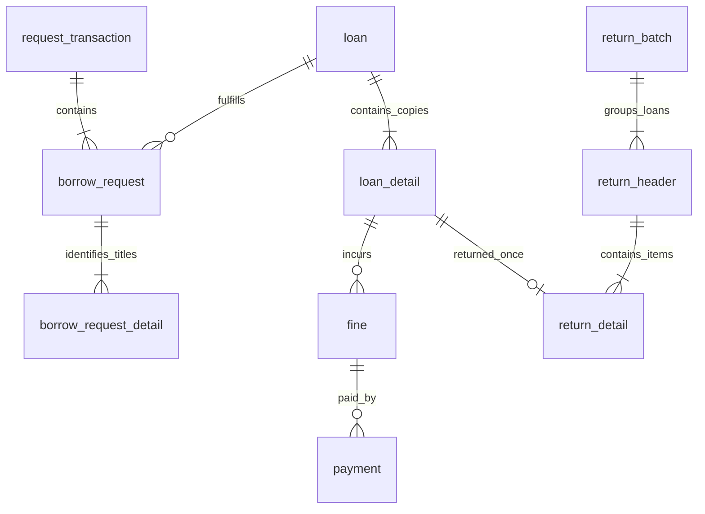

# Library feedback update

This update implements the nine actionable items in the photographed feedback. It retains the existing PHP/MariaDB application and the improved text-only status labels.

## What staff and members will see

| Feedback | Implemented behavior |
| --- | --- |
| Display by transaction, not by book | Borrow requests have one RQ reference per submission. Staff/member lists paginate those headers and expand to show all books. Loans and return history are grouped by their loan/return references. Dashboard request/return entries link to the corresponding transaction. |
| Search in lists | Requests, loans, returns, fines, payments, member loans/fines, categories, publishers, sections, policies, donors, staff and roles now have server-side search. Existing catalog, copies, authors, members, shelves, activity and visit searches remain. |
| User-entered accession numbers | Staff enter one unique accession number per copy when creating books or adding copies. Values must match the copy count, contain at most 40 characters, and cannot duplicate an existing number. A failed batch adds no copies. Existing numbers are preserved. |
| Two or more reservations for one book | Eligible members receive copies in request-date/ID order. Manual approval cannot jump ahead of an earlier eligible reservation. Ineligible members retain their queue position while the next eligible member can receive a copy. |
| Cancellation | Members cancel their own selected pending/held items. Staff can cancel selected items in a transaction. Held copies are released and offered to the queue. Reasons and final statuses remain in history. Fulfilled loans cannot be cancelled as requests. |
| Process multiple books together | A catalog basket creates one transaction. Selected approvals, rejections and cancellations succeed together or roll back. Selected held books are released into one loan with multiple loan-detail rows and individual due dates. |
| Validate reservation limits | Borrowed books plus pending/held catalog and kiosk borrowing requests consume the same allowance. Limits are checked on the server. Direct desk loans cannot bypass reserved slots. Submission/release retries and concurrent workers were tested. |
| Penalties during returns | Staff select returned books and conditions, review the calculated overdue/damage/loss penalties, then confirm. Return details and fines are saved together. The receipt links authorized staff to payment entry. Payment remains a separate step; returning a book does not automatically mark a fine paid. |
| Header–detail database design | New request and return batch headers group existing detail structures with foreign-key links. Multi-book release uses the existing loan header/detail relationship. Historical IDs and values are retained. |

## Daily workflow

1. In Books or Book Copies, enter the actual accession numbers, one per line, matching the number of physical copies.
2. Members select books in the catalog and submit the basket. It receives one RQ reference.
3. Staff open Borrow Requests, expand the transaction, select books and choose Approve selected. Reservation order and borrowing rules are enforced.
4. When the member collects held books, select them and choose Release selected together. One loan number covers that release.
5. In Returns, expand one or more outstanding loans, select physically returned books, choose their conditions, and click Review selected returns and penalties. Confirm after checking the amounts.
6. Use the return receipt's Record payment links if authorized. Unreturned books remain on their loan; assessed fines stay unpaid until payment is recorded.

## Data design

`request_transaction` stores the member, submission time and optional unique submission token. `borrow_request.TransactionID` connects each decision/hold item to the submission; `ReleasedLoanID` connects all released items to their common loan. The existing `borrow_request_detail` title mapping is retained for compatibility with older records.

`return_batch` stores the processing event; `return_header.ReturnBatchID` groups the per-loan returns within that event. `return_detail` continues to identify each physical loan item and condition. The existing unique return-per-loan-item constraint remains in place.

Historical requests receive separate headers because the original submission group cannot be inferred reliably. Existing loan and return references are not renumbered or merged. A later partial release gets a new loan, while remaining linked to its original request transaction.

## Installation for a collaborator

This package updates the existing Release 1 project with the status-label update. Back up the project and database, review/merge the supplied files, and run from the project folder:

    & C:\xampp\php\php.exe database\setup.php
    & C:\xampp\php\php.exe database\setup.php --status

The installer backs up an existing database before applying `migrate_feedback.php`. Rerunning it skips completed migrations. Do not edit previously applied migrations or drop/import over the existing tables.

## Validation

Use only an explicitly named `library_test_*` database with `LIBRARY_TEST_MODE=1`, preferably on a separate MariaDB instance. See SETUP.md for the connection variables.

    & C:\xampp\php\php.exe tests\feedback_test.php
    & C:\xampp\php\php.exe tests\feedback_concurrency_test.php
    python tests\feedback_http_test.py

The HTTP test requires LIBRARY_TEST_URL and LIBRARY_TEST_ADMIN_PASSWORD for a disposable test administrator, and refuses to post unless the server identifies the expected test database.

Validation covers 40 feedback rules, 4 concurrent request scenarios, 14 feedback HTTP checks, the existing 21 core behavior checks, 14 existing HTTP workflow checks and 2 desk concurrency checks. Browser checks cover grouped request details, multi-book selection, the return review and confirmation, plus light/dark readability. Existing and new PHP sources pass syntax checks.

## Existing issues outside this update

The previously reported copy marked Borrowed without an open loan and MariaDB storage-log warnings need separate investigation. Historical discrepancies were not silently corrected. Current lending/late/damage/loss rates are retained: overdue charges follow policy, damage uses half the recorded acquisition cost, and loss uses the recorded acquisition cost.
